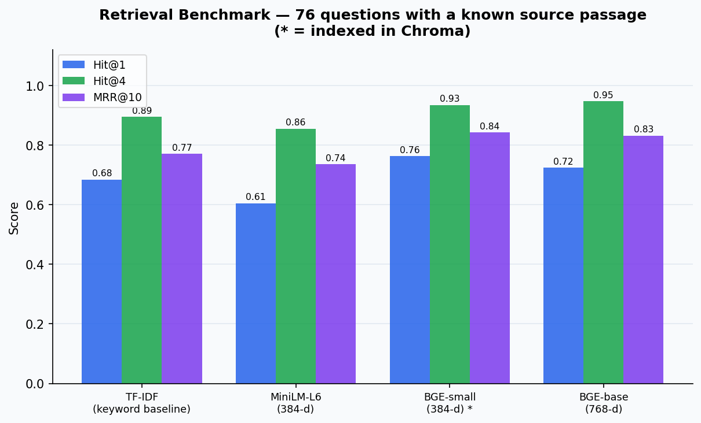
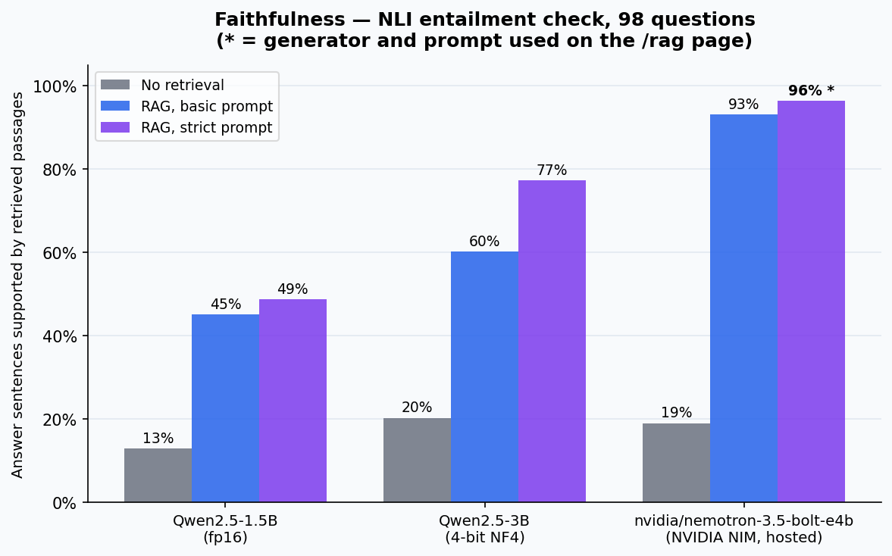

# Steel QC Knowledge Assistant: RAG Case Study

## Why this layer exists

The computer-vision case study classifies steel surface defects. A quality team also needs answers to process questions: what causes mill scale, when a control chart signals a special cause, how magnetic particle inspection works. This layer adds a retrieval-augmented assistant for those questions and, more importantly, measures it:

- **Retrieval quality**: does the system find the passage that actually answers the question?
- **Faithfulness**: is each sentence of the generated answer supported by the passages it retrieved?
- **Projection fidelity**: how much does the 3D picture of the embedding space distort what the system really does?

Retrieval, scoring and two local generators run on one laptop GPU. A third generator, `nvidia/nemotron-3.5-bolt-e4b`, is called on NVIDIA NIM (free API tier, OpenAI-compatible) with greedy decoding; its answers are cached and precomputed for the page, so no key ships with it.

## System

```
43 Wikipedia articles (CC BY-SA)
        |  section-aware chunking (~140 words)
        v
728 passages ──> BGE-small-en-v1.5 embeddings (384-d) ──> Chroma (HNSW, cosine)
                                                              |
question ──> same embedding model ──> top-4 passages ─────────┘
        |
        v
LLM answers with citations (local Qwen / hosted Nemotron) ──> NLI claim check
        |
        v
UMAP 3D / 2D map + precomputed example questions (/rag page)
```

| Component | Choice | Why |
|-----------|--------|-----|
| Knowledge base | 43 English Wikipedia articles in 6 topics; revision ids recorded in `corpus.json` | Real, licensed text a steel QC team touches: defects, rolling, corrosion, SPC, NDT, machine vision |
| Chunking | Sentence packing to ~140 words (max 200), never crossing a section; max 32 passages per article | Keeps passages self-contained and stops long articles from dominating |
| Embeddings | `BAAI/bge-small-en-v1.5`, selected by benchmark (below) | Best MRR@10 of three models |
| Vector database | Chroma, HNSW index, cosine space | Chroma's top-4 matched exact search on 100% of 98 queries |
| Generators compared | `Qwen/Qwen2.5-1.5B-Instruct` (fp16) and `Qwen/Qwen2.5-3B-Instruct` (4-bit NF4) locally; `nvidia/nemotron-3.5-bolt-e4b` on NVIDIA NIM | The Qwen models fit a 6 GB GPU; Nemotron tests a hosted model on identical inputs. Chosen by measured faithfulness |
| Faithfulness judge | `cross-encoder/nli-deberta-v3-base` | Open NLI model; checks entailment sentence by sentence |
| Projection | UMAP (cosine, 15 neighbours, min_dist 0.4), fitted on passages; questions placed with the fitted transform | Preserves local neighbourhoods far better than PCA (below) |

## Evaluation set

Two question sets, both published in [`eval-set.json`](data/rag-knowledge-assistant/eval-set.json):

- **76 generated questions with a known source passage.** Two passages of at least 70 words were sampled per article (seed 42) and Qwen2.5-1.5B wrote one question per passage. 86 were generated and 76 passed the filter (self-contained, ends with "?", no "the passage"). Retrieval is scored at passage level: the exact source passage must come back. Mean lexical overlap between question and source passage is 0.56, so many questions reuse the passage's key terms, which favours keyword search.
- **22 hand-written questions labelled at article level.** Operator-style questions (for example *"What is the difference between hot rolling and cold rolling of steel?"*), each labelled with the article(s) that answer it. The first six are the example questions on the `/rag` page.

## Retrieval results



| Retriever | Hit@1 | Hit@4 | MRR@10 | Hand-written: right article @1 |
|-----------|-------|-------|--------|-------------------------------|
| TF-IDF keyword baseline | 0.684 | 0.895 | 0.770 | 1.000 |
| MiniLM-L6 (384-d) | 0.605 | 0.855 | 0.736 | 1.000 |
| **BGE-small (384-d), selected** | **0.763** | 0.934 | **0.843** | 1.000 |
| BGE-base (768-d) | 0.724 | **0.947** | 0.831 | 1.000 |

- BGE-small puts the exact source passage in the top 4 for 93.4% of generated questions (TF-IDF: 89.5%) and ranks it first more often than the larger BGE-base, which edges it on Hit@4 (94.7%). Top 4 is what the LLM actually reads; selection is by MRR@10.
- The keyword baseline is strong here because generated questions borrow the passage's wording. A small, older embedding model (MiniLM) loses to it. Choosing a retriever without a baseline would have hidden that.
- On the hand-written questions every retriever finds the right article in the top 5. That set is easier at article level and too small to separate the models; it mainly guards against the generated set being unrepresentative.

## Generation and faithfulness



**How faithfulness is scored.** Each answer is split into sentences (citations removed, fragments under four words dropped). A sentence counts as *supported* when the NLI model gives entailment ≥ 0.5 against at least one 1–3 sentence window of the four retrieved passages. Scoring against windows instead of whole passages matters: MNLI-trained models under-score entailment when the premise is a 150–200 word passage. Two example sentences that closely restate a passage (on mill scale composition and on passive-film breakdown in pitting) scored 0.018 and 0.003 against the whole passage, and 0.997 against the matching window.

**Control.** The same model answers the same questions without retrieval, and those answers are scored against the same passages. This separates "the answer is grounded in what was retrieved" from "the answer happens to agree with Wikipedia".

**Results (98 questions: 76 generated + 22 hand-written).**

| Generator | Prompt | Sentences supported | Mean faithfulness per answer | Fully supported answers | Declined |
|-----------|--------|--------------------|------------------------------|-------------------------|----------|
| Qwen2.5-1.5B (fp16) | no retrieval (control) | 13.0% | 0.132 | 0.0% | 0.0% |
| Qwen2.5-1.5B (fp16) | basic | 45.1% | 0.489 | 16.3% | 0.0% |
| Qwen2.5-1.5B (fp16) | strict | 48.8% | 0.476 | 21.4% | 0.0% |
| Qwen2.5-3B (4-bit) | no retrieval (control) | 20.3% | 0.194 | 2.0% | 0.0% |
| Qwen2.5-3B (4-bit) | basic | 60.2% | 0.608 | 38.1% | 1.0% |
| Qwen2.5-3B (4-bit) | strict | 77.3% | 0.778 | 71.1% | 1.0% |
| Nemotron 3.5 Bolt E4B (NIM) | no retrieval (control) | 19.1% | 0.191 | 2.0% | 0.0% |
| Nemotron 3.5 Bolt E4B (NIM) | basic | 93.2% | 0.939 | 83.2% | 3.1% |
| **Nemotron 3.5 Bolt E4B (NIM)** | **strict (selected)** | **96.4%** | **0.966** | **92.1%** | 9.2% |

*Basic prompt:* answer only from the numbered passages and cite them. *Strict prompt:* additionally answer in English, forbid background knowledge and conclusions the passages do not state, and cite a passage for every sentence.

What the numbers say:

- **Retrieval is what grounds the answer.** For the selected model, 96.4% of sentences are entailed by the retrieved passages; the same model answering without retrieval reaches 19.1% against the same passages.
- **The hosted model is far more faithful on identical inputs.** Same passages, same prompts, same judge: Nemotron supports 96.4% of sentences against 77.3% for the best local configuration, and 92.1% of its answers are fully supported (Qwen2.5-3B: 71.1%). Without retrieval it is no better than Qwen2.5-3B (19.1% vs 20.3%), so the gain is in staying inside the sources, not in knowing more. It pays for that with more refusals: 9.2% of questions are declined, against 1.0% for Qwen2.5-3B.
- **Prompt effects depend on the model.** The strict prompt raised the 3B model's support from 60.2% to 77.3% and Nemotron's from 93.2% to 96.4%, but barely moved the 1.5B model (45.1% to 48.8%, while its mean per-answer score fell slightly). The smallest model does not follow the "no background knowledge" instruction reliably. The generator and prompt used on the page were picked by mean faithfulness, not by reading a few answers.
- **Generated and hand-written questions now score alike.** With the selected configuration, 96.5% of sentences are supported on generated questions and 96.2% on the broader hand-written ones; with Qwen2.5-3B the hand-written set was clearly harder.
- **Declining is sometimes the right answer.** The selected model answers *"I don't know based on the provided sources."* for 9 of 98 questions instead of filling gaps from background knowledge; without retrieval, the same model answers everything, and most of those sentences are not supported by the sources.
- When the exact source passage is retrieved (71 of the 76 generated questions that were answered), 96.4% of sentences are supported; when it is missed (5 questions), 100%: other retrieved passages also contained the answer. Five questions are too few to read much into the second number.

## The 3D map and its honesty check

The map on `/rag` shows every passage as a point in a UMAP projection of the 384-dimensional embedding space. Choosing an example question places the question with the same fitted UMAP transform, draws lines to the retrieved passages and makes them glow.

The glowing passages always come from the full-dimensional Chroma search, not from what looks closest in 3D. The page says this under the chart and quantifies the distortion:

| Check | UMAP 3D | UMAP 2D | PCA 3D |
|-------|---------|---------|--------|
| Trustworthiness, k = 10 (passage neighbourhoods preserved) | 0.991 | 0.990 | 0.893 |
| Real top-4 among the 4 points nearest the question on screen (mean of 98 questions) | 1.6 of 4 | 1.6 of 4 | — |

- Passage-to-passage neighbourhoods survive the projection well; UMAP clearly beats PCA here.
- Question-to-passage distances do not survive: in 3D, all four on-screen neighbours of a question are real results for only 2.0% of questions, and none are for 19.4%. A question is placed with UMAP's `transform`, which is an approximation for points the projection was not fitted on.
- This is why the highlighted passages come from the full-dimensional search. The page states the per-question overlap under the map, so a viewer never has to take the 3D distances on trust.

Performance: Three.js is loaded with a dynamic `import()` only when the map section is about to scroll into view (IntersectionObserver, 200 px margin). Phones (< 768 px), users with `prefers-reduced-motion`, and browsers without WebGL get a 2D canvas version drawn from a separate 2D UMAP fit. Desktop users can switch between the two.

## Reproduce

```bash
pip install -r requirements-dev.txt -r requirements-rag.txt   # CUDA build of torch recommended
python analysis/run_rag_case_study.py      # fetch corpus, benchmark, index, generate, score, project
# optional third generator: NVIDIA_API_KEY=... NIM_MODEL=nvidia/nemotron-3.5-bolt-e4b python analysis/run_rag_case_study.py
python analysis/generate_rag_visuals.py    # README charts from the JSON artifacts
python main.py                             # http://127.0.0.1:8080/rag
```

Model outputs, embeddings and the Wikipedia fetch are cached in `analysis/.cache/rag/`, so a re-run only recomputes what changed. All published numbers live in [`docs/data/rag-knowledge-assistant/`](data/rag-knowledge-assistant/).

## Limitations

- Generated questions come from single passages, which makes retrieval easier than real user questions. The hand-written set is small (22).
- Some generated questions are generic enough that several passages answer them; passage-level Hit@k counts those as misses, so it is a conservative measure.
- Faithfulness is not correctness. A supported sentence can still be an incomplete answer, and the NLI judge has its own errors, especially on paraphrase and on numbers.
- The Wikipedia fetch takes the current revision; the recorded revision ids show which text was embedded, but a re-run on a later day can see different text (19 of 43 articles changed between the first run and this one).
- The hosted generator was run once with greedy decoding (temperature 0); NIM does not promise bit-identical outputs over time, so the cached answers in `analysis/.cache/rag/` are the reproducible record.
- Small local generators add background knowledge the sources do not state. The claim check on the page shows this sentence by sentence instead of hiding it.
- The knowledge base is encyclopaedic, not a plant's own SOPs or inspection records. This demonstrates the method, not a deployable assistant.
